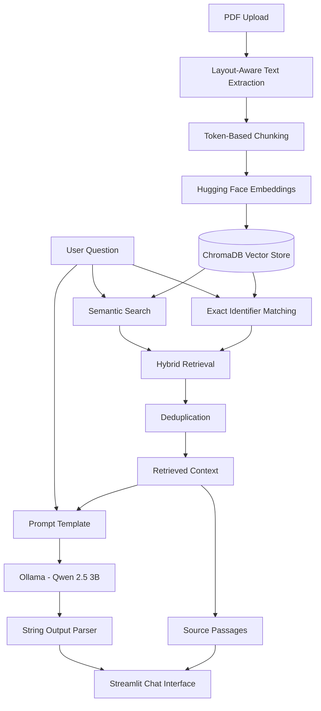

<div align="center">

# 🧠 DocuMind AI

### Privacy-Focused Local Document Intelligence

A local Retrieval-Augmented Generation (RAG) application
that enables users to upload PDF documents, ask natural
language questions, and receive context-grounded answers
with inspectable source passages — without paid AI APIs.


</div>

---

## Overview

DocuMind AI is an end-to-end document question-answering
application built using Python, LangChain, Streamlit,
ChromaDB, Hugging Face embeddings, and locally hosted
Qwen 2.5 through Ollama.

Instead of relying entirely on the language model's
pretrained knowledge, the application retrieves relevant
passages from an uploaded PDF and supplies them as context
during answer generation.

The project demonstrates practical AI engineering,
information retrieval, modular software architecture,
automated testing, and continuous integration.


## Key Features

- **Local LLM inference:** Runs Qwen 2.5 3B using Ollama.
- **Dynamic PDF uploads:** Supports text-based PDF documents.
- **Automatic indexing:** Processes documents on the first query.
- **Token-based chunking:** Preserves context using overlapping chunks.
- **Semantic search:** Retrieves passages using vector similarity and MMR.
- **Exact identifier matching:** Improves retrieval of course codes and similar identifiers.
- **Hybrid retrieval:** Combines semantic and identifier-based search.
- **Layout-aware extraction:** Helps preserve structured PDF content.
- **Source transparency:** Displays retrieved passages and their page numbers.
- **Streaming responses:** Generates answers progressively.
- **Session-based chat history:** Retains messages during the active session.
- **Resource caching:** Avoids repeatedly loading embedding models.
- **Document isolation:** Creates a separate vector collection for each indexed document.
- **Automated testing:** Includes 15 passing local test cases.
- **Continuous integration:** Automated testing through GitHub Actions.

## System Architecture



## How the RAG Pipeline Works

### 1. Document Ingestion

Uploaded PDF documents are processed using pypdf.
Text is extracted while retaining page-level metadata.

### 2. Text Chunking

Documents are divided into overlapping token chunks.

| Parameter | Configuration |
|---|---|
| Token encoding | cl100k_base |
| Chunk size | 200 tokens |
| Chunk overlap | 40 tokens |

This helps maintain context between neighboring passages.

### 3. Embedding Generation

The application uses the following sentence transformer:

```text
sentence-transformers/all-MiniLM-L6-v2
```

The embedding model converts text into 384-dimensional
numerical vectors for semantic retrieval.

### 4. Hybrid Retrieval

The retrieval mechanism combines:

- Maximal Marginal Relevance (MMR).
- Semantic similarity search.
- Regular-expression-based identifier matching.
- Retrieved passage deduplication.

Exact identifier matches are prioritized before semantic
results when a supported identifier appears in the query.

| Retrieval parameter | Value |
|---|---|
| Maximum retrieved chunks | 8 |
| MMR lambda multiplier | 0.7 |

### 5. Context-Grounded Generation

The retrieved passages and original question are combined
into a structured prompt.

The local Qwen language model generates an answer using
the supplied document context.

Retrieved source excerpts are displayed separately so
users can inspect the evidence behind the response.

## Technology Stack

| Component | Technology |
|---|---|
| Programming language | Python 3.13 |
| Frontend | Streamlit |
| AI orchestration | LangChain |
| Language model | Qwen 2.5 3B |
| Local inference | Ollama |
| Embedding model | all-MiniLM-L6-v2 |
| Vector database | ChromaDB |
| PDF processing | pypdf |
| Tokenization | tiktoken |
| Automated testing | Pytest |
| Continuous integration | GitHub Actions |
| Version control | Git and GitHub |

## Project Structure

```text
DocuMind-AI/
├── .github/
│   └── workflows/
│       └── ci.yml
├── .streamlit/
│   └── config.toml

├── tests/
│   └── test_rag_engine.py
├── app.py
├── rag_engine.py
├── Intro_to_AI_Transcript.pdf
├── requirements.txt
├── requirements-dev.txt
├── .gitignore
└── README.md
```

### Software Architecture

| Module | Responsibility |
|---|---|
| app.py | User interface and session management |
| rag_engine.py | PDF extraction, chunking, indexing, retrieval and generation |
| test_rag_engine.py | Automated validation of core application logic |
| ci.yml | Continuous integration workflow |
| config.toml | Application theme and server configuration |

## Installation

### Prerequisites

- Python 3.13
- Git
- Ollama
- Sufficient RAM for local model inference

Download Ollama from:

https://ollama.com/download

### 1. Clone the Repository

```bash
git clone https://github.com/JaberAhmad555/DocuMind-AI.git
cd DocuMind-AI
```

### 2. Create a Virtual Environment

```bash
python -m venv .venv
```

Windows PowerShell:

```powershell
.venv\Scripts\activate
```

Linux and macOS:

```bash
source .venv/bin/activate
```

### 3. Install Dependencies

```bash
python -m pip install -r requirements.txt
```

### 4. Download the Local Language Model

```bash
ollama pull qwen2.5:3b
```

Ensure Ollama is running before starting the application.

### 5. Launch DocuMind AI

```bash
python -m streamlit run app.py
```

Open the application at:

```text
http://localhost:8501
```

The embedding model is downloaded automatically during
its first initialization.

No OpenAI API key is required.

## Usage

1. Start the Streamlit application.
2. Upload a text-based PDF using the sidebar.
3. Enter a question about the document.
4. Wait for automatic document indexing.
5. Read the generated answer.
6. Expand Retrieved Source Passages to inspect the context.

The included Introduction to AI document can also be
used without uploading a separate PDF.

### Example Questions

- What is machine learning?
- Explain the difference between AI and deep learning.
- How does Retrieval-Augmented Generation work?
- Summarize the key concepts in the document.
- What is the purpose of vector embeddings?

## Testing

Install development dependencies:

```bash
python -m pip install -r requirements-dev.txt
```

Run the test suite:

```bash
python -m pytest tests/ -v
```

### Local Test Results

```text
15 passed in 0.52s
```

The test suite validates:

| Test Category | Coverage |
|---|---|
| Identifier matching | Supported identifier formats |
| Invalid identifiers | Incorrect identifier rejection |
| Duplicate removal | Retrieved passage deduplication |
| Source preparation | Page metadata and text |
| Context formatting | Prompt context construction |
| Hybrid retrieval | Exact-match prioritization |
| Semantic retrieval | Standard retrieval logic |
| Empty vector store | Safe empty-result handling |
| PDF extraction | Sample document processing |
| Empty PDFs | Unreadable document handling |

The retrieval tests use mocked dependencies and do not
require live LLM inference or model downloads.

These tests validate application logic rather than
measuring the factual accuracy of generated answers.

## Privacy and Local Execution

DocuMind AI performs document embedding, vector retrieval,
and language model inference locally.

- No paid external LLM API is required.
- Uploaded PDFs are processed within the application.
- Document vector collections are held in memory.
- The server binds to the local interface by default.
- Private documents and generated databases are excluded
  from version control.

Internet access may be required for the initial
installation and model downloads.

## Limitations

- Supports text-based PDFs; OCR is not implemented.
- Processes one active document at a time.
- Complex tables may not extract perfectly.
- Generated answers may contain inaccuracies.
- Retrieved passages are evidence, not a guarantee that
  every generated claim is supported.
- Chat history is displayed but is not passed to the
  model as conversational memory.
- Response speed depends on available hardware.
- Automated tests do not cover live model inference.

## Future Improvements

- Multi-document question answering.
- OCR support for scanned documents.
- Conversational memory.
- BM25 and vector-based ensemble retrieval.
- Reranking and retrieval evaluation.
- Configurable language models.
- FastAPI backend integration.
- Docker-based deployment.
- Automated RAG evaluation metrics.

## Acknowledgments

This project began as a hands-on RAG learning exercise
and was extended with local inference, custom document
uploads, hybrid retrieval, source inspection, modular
architecture, automated tests, and continuous integration.

Built using open-source technologies including LangChain,
Streamlit, Ollama, Hugging Face, ChromaDB, and pypdf.

## Author

**Jaber Ahmad**

Computer Science and Engineering  
Python Software Engineering | AI/ML | Generative AI

GitHub: [JaberAhmad555](https://github.com/JaberAhmad555)

---

<div align="center">

**DocuMind AI — Intelligent answers, grounded in your documents.**

⭐ If you find this project useful, consider starring the repository.

</div>
